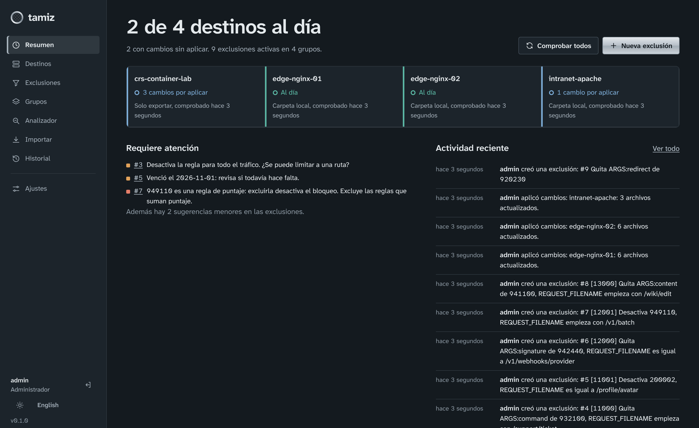

# Tamiz

[English](README.md) · **Español**

**Administra las exclusiones de ModSecurity / OWASP CRS de muchos WAF desde una sola interfaz web.**

Tamiz guarda todas las exclusiones de reglas en un solo lugar, organizadas por aplicación, cada una con su motivo y su fecha de revisión. Las escribe en cada WAF por SSH, por la API de Docker, en un directorio montado o en un paquete descargable. Valida antes y después, recarga, comprueba que las reglas de verdad se cargaron y restaura los archivos anteriores si algo falla.

> Estado: **alfa** (0.1.0). Probado de punta a punta contra nginx + libmodsecurity 3 y Apache + mod_security2 con el OWASP CRS. Algunas partes todavía no se han probado contra sistemas reales: ver [Sin probar todavía](#sin-probar-todavía).



- [Qué hace](#qué-hace)
- [Cómo funciona](#cómo-funciona)
- [Requisitos](#requisitos)
- [Instalar con Docker](#instalar-con-docker)
- [Configuración](#configuración)
- [Publicarlo con TLS](#publicarlo-con-tls)
- [Usuarios, roles y tokens de API](#usuarios-roles-y-tokens-de-api)
- [Conectar tu primer WAF](#conectar-tu-primer-waf)
- [Otras plataformas](#otras-plataformas)
- [Otras formas de llegar a un WAF](#otras-formas-de-llegar-a-un-waf)
- [Uso diario](#uso-diario)
- [Respaldo y restauración](#respaldo-y-restauración)
- [Actualizar](#actualizar)
- [Solución de problemas](#solución-de-problemas)
- [Seguridad](#seguridad)
- [Sin probar todavía](#sin-probar-todavía)
- [Correrlo sin Docker](#correrlo-sin-docker)
- [Desarrollo](#desarrollo)
- [Licencia](#licencia)

## Qué hace

- **Exclusiones como datos**: de tiempo de ejecución (`ctl:ruleRemoveById`, `ctl:ruleRemoveTargetById`, `ctl:ruleEngine`) con condiciones de ruta, host, método o IP, y de configuración (`SecRuleRemoveById`, `SecRuleUpdateTargetById`…). Cualquier otra cosa se puede escribir como SecLang crudo.
- **Grupos con bloques de IDs**: cada aplicación tiene su propio bloque de IDs de reglas dentro del rango de uso local (1–99,999). Así los IDs nunca chocan y dicen de quién es cada regla.
- **Planear y después aplicar**: ves el `diff` exacto de cada archivo antes de que se escriba nada. Aplicar es todo o nada en cada WAF: copia → escritura atómica → validación (`nginx -t`, `apachectl -t`…) → recarga; o se restaura y no se recarga.
- **Comprueba que el WAF de verdad lo cargó**: etiquetas de SELinux, la posición de cada archivo respecto al CRS en el orden de carga real, y el conteo de reglas que reporta la validación.
- **Nunca sobrescribe lo que no escribió**: las ediciones a mano y los archivos desconocidos bloquean el plan hasta que alguien decide.
- **Dos formas de acomodar los archivos**: un archivo por grupo en directorios propios (dos líneas `Include` y el mínimo de sudo), o bloques administrados dentro de archivos existentes, como `REQUEST-900-EXCLUSION-RULES-BEFORE-CRS.conf`.
- **Analizador de logs**: lee audit logs (serial o JSON, ModSecurity v2/v3, Coraza) o error logs y propone la exclusión más acotada para cada falso positivo.
- **Importa exclusiones existentes** sin cambiar lo que hacen (las reglas que no reconoce se conservan tal cual), las renumera en el bloque del grupo y las retira del archivo original en la misma aplicación.
- **Linter** para exclusiones riesgosas: quitar reglas de puntaje, apagar el motor, reglas quitadas para todo el tráfico…
- **Revisión de otra persona** por WAF, historial completo, roles (viewer, editor, admin), usuarios locales o inicio de sesión único mediante un proxy que autentica, y tokens de API.
- Interfaz en español e inglés; HTML, CSS y JavaScript simples (sin paso de compilación).

## Cómo funciona

```text
grupos + exclusiones (en Tamiz)
        │  se generan: un archivo determinista por grupo, o bloques en archivos existentes
        ▼
plan por WAF: crear / actualizar / borrar, con su diff; los archivos editados a mano o desconocidos lo bloquean
        │  aplicar (solo el plan que viste, identificado por su huella)
        ▼
copia → escritura atómica → validar → recargar → verificar (SELinux, orden de carga, conteo de reglas)
        └── si la validación falla: restaura la copia y no recarga
```

A un WAF que Tamiz administra se le llama **destino**. Las exclusiones de tiempo de ejecución van en archivos que se cargan **antes** de las reglas del CRS; las de configuración, en archivos que se cargan **después**. Tamiz escribe sus archivos, y el WAF los carga con dos líneas `Include` que agregas una sola vez.

Tamiz es un solo proceso de Python con SQLite. No necesita una base de datos externa ni corre tareas en segundo plano: todo pasa cuando alguien hace clic o llama a la API.

## Requisitos

- **Docker** con el plugin de Compose (`docker compose`). También corre sin Docker: ver [Correrlo sin Docker](#correrlo-sin-docker).
- **Acceso de red** desde el servidor de Tamiz a cada WAF: SSH en la mayoría de los casos. Alternativas: la API de Docker, o el directorio del WAF montado en Tamiz.
- **Un WAF** con ModSecurity y el OWASP CRS, alguno de estos:
  - nginx + libmodsecurity 3;
  - Apache httpd + mod_security2;
  - la imagen de contenedor `owasp/modsecurity-crs`;
  - Caddy + Coraza.

  Las pruebas de punta a punta corren con paquetes de Ubuntu 24.04: nginx 1.24, libmodsecurity 3.0.12 y CRS 3.3.5, y Apache con mod_security2.
- **En cada servidor WAF**: un usuario dedicado para Tamiz y `sudo` para unos pocos comandos (Tamiz te sugiere la línea exacta).
- **Un proxy inverso con TLS** si otras personas van a usar Tamiz desde otras máquinas. De fábrica solo escucha en `127.0.0.1`.

## Instalar con Docker

```bash
git clone https://github.com/Zaporitecua/tamiz.git && cd tamiz
cp .env.example .env

# Llave SSH con la que Tamiz entrará a tus servidores WAF (o copia aquí una que ya tengas)
mkdir -p keys
ssh-keygen -t ed25519 -N '' -C tamiz -f keys/tamiz_ed25519
sudo chown 10001 keys/*          # el contenedor corre como uid 10001

docker compose up -d --build
docker compose logs tamiz | grep "setup code"
```

Abre <http://127.0.0.1:8080>, escribe el código de instalación y crea el primer administrador (contraseña de al menos 10 caracteres). El código se vuelve a imprimir en cada arranque mientras no exista un administrador.

Para no usar el código, define `TAMIZ_ADMIN_USER` y `TAMIZ_ADMIN_PASSWORD` en `.env` antes del primer arranque. Después, borra la contraseña del archivo.

Comprueba que está sano:

```bash
docker compose ps                         # STATUS: healthy
curl -s http://127.0.0.1:8080/api/health  # {"status":"ok","version":"0.1.0"}
docker compose logs --tail 20 tamiz       # "Tamiz 0.1.0 ready (schema 1, auth local)"
```

Qué queda dónde:

| En el contenedor | Qué es | De dónde sale |
|---|---|---|
| `/data/tamiz.db` | la base de datos: exclusiones, grupos, destinos, usuarios, historial, copias | volumen `tamiz-data` |
| `/data/secret.key` | la llave que cifra las contraseñas y llaves pegadas que se guardan; se crea con la primera (salvo que definas `TAMIZ_SECRET_KEY`) | volumen `tamiz-data` |
| `/keys` | llaves privadas SSH y certificados de cliente de Docker, solo lectura | `./keys` |
| `/waf/…` | directorios del WAF para el transporte local (opcional) | lo que montes |
| `/var/run/docker.sock` | transporte Docker (opcional; lee antes [Seguridad](#seguridad)) | el socket del host |

La base de datos vive en el volumen `tamiz-data`, no dentro del contenedor: sobrevive si el contenedor se cae, se reinicia o se reconstruye. Solo se borra con `docker compose down -v` o si borras el volumen.

## Configuración

Los ajustes de infraestructura son variables de entorno en `.env` y se leen una vez, al arrancar. Un valor inválido detiene el arranque con un mensaje que dice cuál es. Los ajustes que los administradores cambian en la interfaz (rango de IDs, formato de las reglas, si el motivo es obligatorio…) viven en la base de datos, en *Ajustes*.

**Generales**

| Variable | Por defecto | Qué hace |
|---|---|---|
| `TAMIZ_DATA_DIR` | `/data` | Base de datos y `secret.key` (la fija el `Dockerfile`) |
| `TAMIZ_KEYS_DIR` | `/keys` | Llaves SSH y certificados de Docker; los nombres de llave relativos de los destinos se buscan aquí |
| `TAMIZ_LOG_LEVEL` | `INFO` | `DEBUG`, `INFO`, `WARNING` o `ERROR` |
| `TAMIZ_COMMAND_TIMEOUT` | `60` | Segundos por comando remoto, salvo que el destino defina el suyo |

**Autenticación**

| Variable | Por defecto | Qué hace |
|---|---|---|
| `TAMIZ_AUTH_MODE` | `local` | `local` (usuarios guardados en Tamiz), `proxy` (un proxy inverso que autentica inicia la sesión) o `none` (sin inicio de sesión: solo para un laboratorio al que nadie más llega) |
| `TAMIZ_ADMIN_USER`, `TAMIZ_ADMIN_PASSWORD` | — | Crea este administrador al arrancar si no hay ninguno, en lugar del código de instalación |
| `TAMIZ_SESSION_HOURS` | `12` | Duración de la sesión |
| `TAMIZ_COOKIE_SECURE` | `auto` | `auto` (según la petición, o `X-Forwarded-Proto` de un proxy de confianza), `true` o `false`. Detrás de HTTPS, pon `true` |

**Proxies**

| Variable | Por defecto | Qué hace |
|---|---|---|
| `TAMIZ_TRUSTED_PROXIES` | `127.0.0.1/32,::1/128` | Redes (CIDR, separadas por comas) a las que se les cree `X-Forwarded-For`, `X-Forwarded-Proto` y, en modo proxy, el encabezado del usuario |
| `TAMIZ_PROXY_USER_HEADER` | `X-Forwarded-User` | Encabezado con el nombre de usuario (modo proxy) |
| `TAMIZ_PROXY_GROUPS_HEADER` | `X-Forwarded-Groups` | Encabezado con los grupos del usuario, separados por coma o punto y coma |
| `TAMIZ_PROXY_ADMIN_GROUPS` | — | Grupos que reciben el rol admin |
| `TAMIZ_PROXY_EDITOR_GROUPS` | — | Grupos que reciben el rol editor |
| `TAMIZ_PROXY_DEFAULT_ROLE` | `viewer` | Rol para quien no está en ninguno de esos grupos: `viewer`, `editor`, `admin` o `none` (sin acceso) |

**Secretos y transportes**

| Variable | Por defecto | Qué hace |
|---|---|---|
| `TAMIZ_SECRET_KEY` | — | Llave Fernet para las credenciales guardadas. Si está vacía, Tamiz crea `/data/secret.key`. Genera una con `python3 -c "from cryptography.fernet import Fernet; print(Fernet.generate_key().decode())"` |
| `TAMIZ_LOCAL_ROOTS` | `/waf` | Directorios (separados por comas) que el transporte local puede leer y escribir |
| `TAMIZ_DOCKER_HOST` | `unix:///var/run/docker.sock` | API de Docker por defecto para el transporte Docker (`unix://`, `tcp://` o `https://`); cada destino puede usar otra |

Si cambias `TAMIZ_SECRET_KEY` (o pierdes `secret.key`), las contraseñas guardadas ya no se pueden leer y hay que escribirlas de nuevo.

## Publicarlo con TLS

`docker-compose.yml` publica Tamiz solo en `127.0.0.1:8080`. Pon delante un proxy inverso con TLS; `examples/nginx-reverse-proxy.conf` es un ejemplo completo para nginx. También funciona bajo un prefijo de ruta como `/tamiz/`, porque la interfaz usa rutas relativas.

Después, en `.env`:

```bash
TAMIZ_COOKIE_SECURE=true
```

Para que el límite de intentos de inicio de sesión vea la IP real de cada usuario, declara el proxy como de confianza. Un proxy en el mismo servidor llega al contenedor desde la puerta de enlace de la red de Docker, no desde 127.0.0.1:

```bash
docker network inspect tamiz_default -f '{{(index .IPAM.Config 0).Gateway}}'   # <carpeta>_default
# por ejemplo 172.18.0.1  →  TAMIZ_TRUSTED_PROXIES=172.18.0.1/32
docker compose up -d     # aplica el cambio
```

Una aplicación puede tardar en un servidor lento, y los logs que se suben pueden pesar hasta 20 MB. Por eso el ejemplo pone `proxy_read_timeout 180s` y `client_max_body_size 25m`.

## Usuarios, roles y tokens de API

**Roles**: `viewer` < `editor` < `admin`. La API revisa el rol en cada ruta.

| Rol | Puede |
|---|---|
| viewer | Ver todo; comprobar destinos (solo lectura: se conecta y lee los archivos de Tamiz); el orden de carga; descargar paquetes; analizar logs pegados; exportar el respaldo JSON; sus propios tokens de API |
| editor | Grupos y exclusiones; asignar grupos a destinos; aplicar, validar y recargar; pedir y decidir revisiones; importar y retirar reglas; analizar logs leídos del servidor |
| admin | Destinos con sus credenciales, comandos y rutas; diagnóstico; restablecer la llave SSH de un servidor; usuarios; ajustes |

**Usuarios locales** (`TAMIZ_AUTH_MODE=local`): contraseñas con hash scrypt y sesiones en una cookie `HttpOnly` y `SameSite=Strict`. Con 5 intentos fallidos de un usuario desde una IP en 15 minutos, ese par queda bloqueado un rato.

**Inicio de sesión único** (`TAMIZ_AUTH_MODE=proxy`): un proxy que autentica (oauth2-proxy, Authelia, Authentik…) inicia la sesión y pasa el nombre de usuario y sus grupos en encabezados. El rol sale de los grupos. Dos condiciones:

- el proxy debe **sobrescribir** el encabezado de usuario que mande el cliente;
- a Tamiz no se debe poder llegar sin pasar por el proxy.

Agrega la dirección del proxy a `TAMIZ_TRUSTED_PROXIES`. El final de `examples/nginx-reverse-proxy.conf` muestra una configuración con oauth2-proxy.

**Tokens de API**: *Ajustes → Tokens de API*. Un token tiene el rol de quien lo creó y una caducidad opcional, y se muestra una sola vez. Se usa como `Authorization: Bearer tmz_…`; las peticiones con token no necesitan el encabezado `X-Tamiz` que sí necesitan las del navegador. La referencia de la API está en `/api/docs`.

## Conectar tu primer WAF

El caso más común: nginx + libmodsecurity 3, por SSH.

### 1. En el servidor WAF

```bash
# Un usuario dedicado con la llave pública de Tamiz (keys/tamiz_ed25519.pub)
sudo useradd --system --create-home --shell /bin/sh tamiz
sudo install -d -m 700 -o tamiz -g tamiz ~tamiz/.ssh
echo 'ssh-ed25519 AAAA... tamiz' | sudo tee ~tamiz/.ssh/authorized_keys
sudo chown tamiz: ~tamiz/.ssh/authorized_keys && sudo chmod 600 ~tamiz/.ssh/authorized_keys

# Los directorios propios de Tamiz, de ese usuario
sudo install -d -o tamiz -g tamiz -m 755 /etc/nginx/modsec/tamiz/before /etc/nginx/modsec/tamiz/after
```

En RHEL y sus derivados con SELinux, los directorios nuevos bajo `/etc/nginx` heredan la etiqueta correcta. Tamiz corre `restorecon` después de escribir y revisa el resultado.

### 2. Crear el destino en Tamiz

1. *Destinos → Nuevo destino*, plataforma **nginx + libmodsecurity (v3)**. La plantilla llena rutas típicas: revísalas, cambian entre distribuciones.
2. Conexión: **SSH**, host, puerto, usuario `tamiz`, *Llave en /keys*: `tamiz_ed25519`. También puedes guardar una contraseña o pegar una llave; las dos se guardan cifradas. Se puede pasar por un servidor de salto.
3. *Privilegios*: **Sudo para comandos**. Revisa los comandos para validar, recargar y descubrir, y las rutas de los logs.
4. Archivos: **Un archivo por grupo**, por ejemplo `/etc/nginx/modsec/tamiz/before/{block}-{group}.conf`.
5. Guarda.

### 3. sudo

El formulario muestra una línea de sudoers para ese destino. Cópiala al servidor WAF, por ejemplo:

```text
tamiz ALL=(root) NOPASSWD: /usr/sbin/nginx -t, /usr/sbin/nginx -s reload, /usr/sbin/nginx -T, \
    /usr/bin/tail -c * -- /var/log/modsec_audit.log, /usr/bin/tail -c * -- /var/log/nginx/error.log, \
    /usr/bin/true
```

```bash
sudo visudo -f /etc/sudoers.d/tamiz
sudo visudo -cf /etc/sudoers.d/tamiz
```

Usa rutas completas (`command -v nginx`). `examples/sudoers-tamiz` trae la variante para Apache.

### 4. Diagnóstico

Abre el destino, pestaña *Diagnóstico* (administradores), y dale *Ejecutar diagnóstico*. Prueba la conexión, los directorios con permiso de escritura, sudo, la validación, SELinux y el acceso a los logs.

La primera conexión fija la llave SSH del servidor. Compara la huella que muestra con `ssh-keygen -lf /etc/ssh/ssh_host_ed25519_key.pub` en el servidor.

### 5. Primera aplicación, antes de tocar nginx

Crea un grupo (*Grupos → Nuevo grupo*) y asígnalo al destino. Luego **Comprobar** y **Aplicar**. Tamiz escribe los archivos del grupo y un archivo de relleno (`000-tamiz-keep.conf`) en cada directorio. nginx todavía no los carga.

### 6. Agregar las dos líneas `Include`, una sola vez

En el archivo que carga `modsecurity_rules_file` (muchas veces `/etc/nginx/modsec/main.conf`), pon las dos líneas de Tamiz alrededor de las que cargan el CRS:

```apache
Include /etc/nginx/modsec/modsecurity.conf
Include /etc/nginx/modsec/tamiz/before/*.conf     # nueva: exclusiones de tiempo de ejecución, antes del CRS
Include /etc/nginx/modsec/coreruleset/crs-setup.conf
Include /etc/nginx/modsec/coreruleset/rules/*.conf
Include /etc/nginx/modsec/tamiz/after/*.conf      # nueva: exclusiones de configuración, después del CRS
```

```bash
sudo nginx -t && sudo nginx -s reload
```

Tus rutas del CRS pueden ser otras; lo único que importa es dónde quedan las líneas de Tamiz. El orden de los pasos 5 y 6 también importa: libmodsecurity 3 rechaza un `Include` cuyo comodín no encuentra ningún archivo. Si de todos modos quieres agregar las líneas primero, crea antes los archivos de relleno vacíos. Tamiz adopta los archivos vacíos:

```bash
sudo -u tamiz touch /etc/nginx/modsec/tamiz/{before,after}/000-tamiz-keep.conf
```

### 7. Confirmar

- Pestaña *Orden de carga*: los archivos de Tamiz aparecen con un aro de acero, *before* arriba del CRS y *after* abajo.
- **Comprobar**: el destino dice *Al día*.

De aquí en adelante, cada cambio es: editar exclusiones → **Comprobar** → revisar el `diff` → **Aplicar**.

## Otras plataformas

| Plataforma (plantilla) | Qué cambia |
|---|---|
| **Apache httpd + mod_security2** | Comandos `apachectl -t`, `apachectl graceful`, `apachectl -t -D DUMP_INCLUDES`. Directorios `/etc/modsecurity/tamiz/{before,after}`. Agrega `IncludeOptional /etc/modsecurity/tamiz/before/*.conf` antes de las líneas que cargan el CRS y `…/after/*.conf` después. Debian: `/etc/apache2/mods-enabled/security2.conf`; RHEL: `/etc/httpd/conf.d/mod_security.conf`. Si tus rutas de `Include` son relativas, en *Rutas relativas en Include* elige *Relativas a ServerRoot (Apache)* y llena *ServerRoot* |
| **OWASP CRS container image** (`owasp/modsecurity-crs`) | Transporte Docker, contenedor `waf`. Tamiz escribe `tamiz-…-before.conf` y `-after.conf` en `/etc/modsecurity.d/owasp-crs/plugins/`, que la imagen ya carga alrededor del CRS: no hay que agregar nada. Monta ese directorio como volumen para que los archivos sobrevivan al contenedor. **Rutas no verificadas contra la imagen actual**: confírmalas en *Orden de carga* antes de aplicar. Laboratorio: `examples/crs-container/docker-compose.yml` |
| **Caddy + Coraza** | `caddy validate` / `caddy reload`. Agrega las dos líneas de Tamiz entre las directivas de Coraza de tu Caddyfile, alrededor del CRS. Coraza no tiene `-T`: llena *Archivos de entrada* para que Tamiz pueda seguir el orden de carga. **Sin probar** |
| **Existing exclusion files** (REQUEST-900 / RESPONSE-999) | Modo *Bloques en archivos existentes*: Tamiz edita solo sus propios bloques marcados dentro de esos archivos y conserva todo lo demás. No hay que agregar nada si el CRS carga `rules/*.conf`. Necesita *Sudo para todo*, porque los archivos son de root |
| **Custom** | Todo vacío, para cualquier otra configuración |

Cada destino muestra su propio fragmento `Include` en *Configuración*. Los nombres de las plantillas aparecen en inglés también en la interfaz en español.

## Otras formas de llegar a un WAF

- **WAF en un contenedor en otro servidor, o en Kubernetes**: SSH al servidor, con un *Prefijo de comandos* como `docker exec waf` o `kubectl exec -n waf deploy/waf --`. Si usas sudo, el prefijo también va en la línea de sudoers.
- **WAF en el mismo servidor que Tamiz**: transporte *Carpeta local*. Monta el directorio del WAF bajo `/waf` en `docker-compose.yml` (hay un ejemplo comentado), con permiso de escritura para el uid 10001. Un contenedor normalmente no puede validar ni recargar el nginx del host, así que esos comandos quedan vacíos y recargas fuera de Tamiz. Sin un comando para validar, Tamiz no puede detectar un archivo roto ni volver atrás, así que cuando puedas, prefiere SSH al mismo servidor.
- **Contenedores WAF en el host de Docker**: transporte *API de Docker*. Descomenta la línea de `docker.sock` en `docker-compose.yml`. El contenedor corre como uid 10001, así que dale el grupo del socket: `group_add: ["<gid>"]`, con el gid que da `stat -c %g /var/run/docker.sock`. También funciona una API de Docker remota por `https://` con certificados de cliente en `/keys`. Antes lee lo de Docker en [Seguridad](#seguridad).
- **Sin ningún acceso** (cambios por ticket, Ansible, GitOps): transporte *Solo exportar*. *Descargar paquete* da un `.zip` con los archivos en sus rutas absolutas, un manifiesto con sus huellas y un README. Después de desplegarlo, *Marcar como desplegado*.

## Uso diario

- **Grupos**: normalmente uno por aplicación o sitio. Cada uno tiene su bloque de IDs y se despliega en uno o más destinos.
- **Exclusiones**: mientras escribes, el formulario muestra el SecLang que Tamiz va a escribir y los avisos del linter. Cada exclusión guarda un motivo (en *Ajustes* se puede volver obligatorio) y, si quieres, una referencia y una fecha en *Revisar el*, que da un aviso cuando llega.
- **Analizador**: lee el audit log o el error log de un destino, o uno pegado. Agrupa las coincidencias y convierte los falsos positivos que elijas en un borrador de exclusión. Las reglas de puntaje (949xxx, 980xxx) se listan aparte, a propósito.
- **Importar**: trae exclusiones que ya existen en un servidor, o en texto pegado. Puede renumerarlas en el bloque del grupo y retirarlas del archivo original en la misma aplicación. Retirar de archivos de root necesita *Sudo para todo* mientras migras.
- **Revisiones**: con *Exigir revisión de otra persona antes de aplicar*, un editor pide que revisen el plan exacto y otra persona lo aprueba (salvo que en *Ajustes* actives *Quien pide una revisión también puede aprobarla*).
- **Historial**: cada cambio, aplicación, importación e inicio de sesión, con los pasos de cada aplicación y la copia de los archivos de antes.
- **Ajustes → Datos → Exportar**: grupos y exclusiones en JSON. Sirve para copiarlos a otro Tamiz (pruebas → producción) o para guardarlos en Git. No es un respaldo completo.

## Respaldo y restauración

Respalda la base de datos y la llave de cifrado **juntas**: una sin la otra está incompleta. Juntas dan acceso a tus servidores WAF, así que guárdalas como cualquier otra credencial de administración. Respalda también `./keys` y `.env`.

Respaldo en caliente (SQLite está en modo WAL: no copies el archivo mientras Tamiz está corriendo):

```bash
STAMP=$(date +%Y%m%d-%H%M)
docker compose exec tamiz python -c "
import sqlite3
src = sqlite3.connect('/data/tamiz.db'); dst = sqlite3.connect('/data/backup.db')
src.backup(dst); dst.close(); src.close()"
docker compose cp tamiz:/data/backup.db ./tamiz-$STAMP.db
docker compose cp tamiz:/data/secret.key ./tamiz-$STAMP.key   # existe desde que se guarda la primera contraseña o llave
docker compose exec tamiz rm /data/backup.db
```

Con `TAMIZ_SECRET_KEY`, la llave está en `.env` y no hay `secret.key` que copiar.

Para restaurar, con la imagen que ya construiste (`docker volume ls` muestra el nombre del volumen: `<carpeta>_tamiz-data`):

```bash
docker compose stop tamiz
docker run --rm --user 0 --entrypoint sh \
  -v tamiz_tamiz-data:/data -v "$PWD":/restore tamiz:latest -c '
  rm -f /data/tamiz.db-wal /data/tamiz.db-shm &&
  cp /restore/tamiz-AAAAMMDD-HHMM.db /data/tamiz.db &&
  cp /restore/tamiz-AAAAMMDD-HHMM.key /data/secret.key &&
  chown 10001 /data/tamiz.db /data/secret.key && chmod 600 /data/secret.key'
docker compose start tamiz
```

Con `TAMIZ_SECRET_KEY` no hay archivo `.key`: quita la línea que lo copia.

Después, **Comprobar** cada destino. Lo que haya en los servidores más nuevo que el respaldo aparece como editado a mano (`drift`): Tamiz no lo sobrescribe sin que lo confirmes.

¿Perdiste la llave? La base de datos sigue funcionando; solo las contraseñas guardadas y las llaves pegadas dejan de poder leerse (`secret_unreadable`). Edita esos destinos y escríbelas de nuevo. Las llaves de `./keys` no se ven afectadas.

## Actualizar

```bash
# primero respalda (ver arriba)
git pull
docker compose up -d --build
docker compose logs --tail 20 tamiz     # "Tamiz … ready (schema N, …)"
```

Las migraciones de la base de datos corren solas al arrancar.

`docker compose down` detiene y quita el contenedor, pero conserva los datos. `docker compose down -v` además **borra el volumen de datos**.

## Solución de problemas

Empieza por la pestaña *Diagnóstico* del destino. Los mensajes de la interfaz vienen de códigos, que aparecen abajo entre paréntesis.

| Síntoma | Causa y solución |
|---|---|
| No aparece el código de instalación | `docker compose logs tamiz \| grep "setup code"`. Se imprime en cada arranque mientras no exista un administrador |
| "Petición rechazada por seguridad" (`csrf`) | Falta el encabezado `X-Tamiz`. En el navegador, recarga la página. En scripts, usa un token de API |
| Demasiados intentos (`too_many_attempts`) | 5 fallos en 15 minutos para ese usuario e IP. Espera, o reinicia el contenedor. Si todos los usuarios salen por una misma IP, agrega el proxy a `TAMIZ_TRUSTED_PROXIES` |
| En modo proxy siempre pide iniciar sesión | Si el log dice `ignored X-Forwarded-User header from <ip>`, agrega esa IP a `TAMIZ_TRUSTED_PROXIES`. Si no aparece esa línea, el proxy no está mandando el encabezado de `TAMIZ_PROXY_USER_HEADER` |
| `unreachable` | Red, puerto o nombre. Prueba desde el contenedor: `docker compose exec tamiz python -c "import socket; socket.create_connection(('HOST', 22), 5)"` |
| `auth_failed` | La llave pública no está en el `authorized_keys` del usuario, o los permisos de `~/.ssh` son demasiado abiertos (sshd ignora la llave) |
| `key_not_found` | El nombre no coincide con un archivo de `./keys`, o el uid 10001 no lo puede leer: `sudo chown 10001 keys/*` |
| `host_key_mismatch` | La llave SSH del servidor cambió: reinstalación, otra máquina detrás del nombre, o intercepción. Compara las huellas **por otro medio** y luego *Configuración → Restablecer llave del servidor* |
| sudo pide contraseña | Falta la línea de sudoers o no coincide exactamente (rutas completas, mismos argumentos). En el servidor: `sudo -l -U tamiz` |
| Falla *Comprobar permisos* | El usuario no puede escribir esos archivos: dale con `chown` los directorios de Tamiz, o usa *Sudo para todo* para archivos de root |
| Falló *Validar* y se restauraron los archivos (`rolled_back`) | Lo que se escribió no pasa la validación del WAF; el paso muestra el error del WAF. Con exclusiones estructuradas no debería pasar: sospecha del SecLang crudo |
| Falló *Recargar* (`reload_failed`) | Los archivos son válidos y quedaron escritos, pero falló el comando para recargar. Recarga a mano o desde el destino |
| *Verificar que se cargó*: el conteo de reglas no cambió | Los archivos están en el disco, pero el WAF no los leyó: falta el `Include`, el comodín no los cubre, o es SELinux (`ls -Z`, `restorecon -v <ruta>`) |
| Archivos bloqueados (`drift`, `foreign`) | Alguien editó a mano un archivo de Tamiz, o ya existe un archivo que Tamiz quiere crear. Mira el `diff`; conserva el cambio como exclusión (o impórtalo) y después sobrescribe esa ruta |
| `plan_changed` | Algo cambió desde que viste el plan. **Comprobar** otra vez |

Logs: `docker compose logs -f tamiz`. Los errores inesperados quedan en el log con su traza (`unhandled error on …`).

## Seguridad

Tamiz guarda credenciales de tus servidores WAF y decide qué bloquea tu WAF: trátalo como una herramienta de administración.

- **Mínimo privilegio en los servidores WAF**: un usuario dedicado, los archivos de Tamiz en directorios propios y *Sudo para comandos*. *Sudo para todo* equivale a root: úsalo solo mientras migras reglas de archivos de root.
- **Credenciales**: las contraseñas guardadas y las llaves pegadas se guardan cifradas (Fernet) y la API nunca las devuelve.
- **SSH**: la llave del servidor se fija en la primera conexión (también la del servidor de salto). Si cambia, se detiene todo comando hasta que un administrador la restablezca.
- **Sin inyección de comandos**: el contenido de los archivos y las rutas viajan como argumentos en base64 o como rutas validadas, nunca metidos dentro de un comando.
- **Navegador**: política de seguridad de contenido (CSP) estricta, sin scripts ni estilos en línea; un encabezado contra CSRF en cada cambio; cookies `SameSite=Strict`; contraseñas con hash scrypt; límite de intentos de inicio de sesión.
- **Socket de Docker**: montar `/var/run/docker.sock` le da a Tamiz, y a quien lo controle, control total de todos los contenedores del host, es decir, del host. En orden de preferencia, usa mejor:
  - SSH con `docker exec` como prefijo de comandos;
  - un proxy del socket que solo permita las rutas de exec e inspect;
  - una API de Docker remota por `https://` con certificado de cliente.
- **Lo que una exclusión válida puede hacer**: la validación detecta archivos rotos, no exclusiones demasiado amplias. Para eso están el linter y las revisiones.
- **Lo que no cubre**: no separa organizaciones (todos los usuarios ven todos los destinos), no hay permisos por grupo, no trae segundo factor propio (usa el modo proxy con un proveedor que lo tenga) y no cifra la base de datos más allá de las credenciales.

Para reportar una vulnerabilidad, usa *Report a vulnerability* en la pestaña *Security* del repositorio, no un issue público.

## Sin probar todavía

- El transporte Docker contra un Docker real. Se probó contra una API simulada.
- Las rutas de la plantilla `crs-docker` dentro de la imagen oficial.
- Caddy + Coraza.
- SELinux real. En las pruebas está simulado.
- Prefijos de comandos con `kubectl exec`.
- Servidores de salto SSH.
- Construir la imagen del contenedor. La aplicación sí se ha corrido como la corre la imagen: Python 3.12, uid 10001, el mismo comando y el mismo chequeo de salud.

## Correrlo sin Docker

Python 3.11 o más reciente (la imagen usa 3.12):

```bash
git clone https://github.com/Zaporitecua/tamiz.git /opt/tamiz && cd /opt/tamiz
python3 -m venv .venv && .venv/bin/pip install -r requirements.txt
TAMIZ_DATA_DIR=/var/lib/tamiz TAMIZ_KEYS_DIR=/etc/tamiz/keys \
  .venv/bin/uvicorn tamiz.main:app --host 127.0.0.1 --port 8080 --no-server-header --no-proxy-headers
```

No quites `--no-proxy-headers`: Tamiz lee `X-Forwarded-*` por su cuenta, y solo de `TAMIZ_TRUSTED_PROXIES`. Córrelo con un usuario sin privilegios que sea dueño del directorio de datos. Una unidad de systemd podría verse así, con el resto de las variables en `/opt/tamiz/.env`:

```ini
[Unit]
Description=Tamiz
After=network-online.target

[Service]
User=tamiz
WorkingDirectory=/opt/tamiz
Environment=TAMIZ_DATA_DIR=/var/lib/tamiz TAMIZ_KEYS_DIR=/etc/tamiz/keys
EnvironmentFile=/opt/tamiz/.env
ExecStart=/opt/tamiz/.venv/bin/uvicorn tamiz.main:app --host 127.0.0.1 --port 8080 --no-server-header --no-proxy-headers
Restart=on-failure

[Install]
WantedBy=multi-user.target
```

## Desarrollo

```bash
python3 -m venv .venv && . .venv/bin/activate
pip install -r requirements-dev.txt
python3 -m pytest -q                       # 77 passed, 3 skipped (los laboratorios con WAF reales)
for f in tamiz/static/js/*.js tamiz/static/js/views/*.js; do node --check "$f"; done
mkdir -p data keys waf
TAMIZ_DATA_DIR=./data TAMIZ_KEYS_DIR=./keys TAMIZ_LOCAL_ROOTS=$PWD/waf \
  uvicorn tamiz.main:app --port 8800 --reload --no-proxy-headers
```

El backend es Python con FastAPI y SQLite, sin ORM. La interfaz es HTML, CSS y módulos de JavaScript simples, sin framework y sin paso de compilación. El backend manda códigos de error y la interfaz los traduce: cada código necesita un texto en español y otro en inglés en `tamiz/static/js/i18n.js`, y `tests/test_i18n.py` lo revisa.

Las pruebas de punta a punta contra nginx y Apache reales corren en un Ubuntu 24.04 desechable, como root. Reescriben la configuración del WAF, así que nunca las corras contra un servidor real:

```bash
sh tests/e2e/lab-nginx.sh && sh tests/e2e/lab-apache.sh
TAMIZ_E2E=1 python3 -m pytest -q tests/e2e
```

Los reportes de errores y los pull requests son bienvenidos en GitHub Issues.

## Licencia

Apache License 2.0. Ver `LICENSE` y `NOTICE`. Las fuentes incluidas (Atkinson Hyperlegible Next y Mono) están bajo la SIL Open Font License 1.1.
