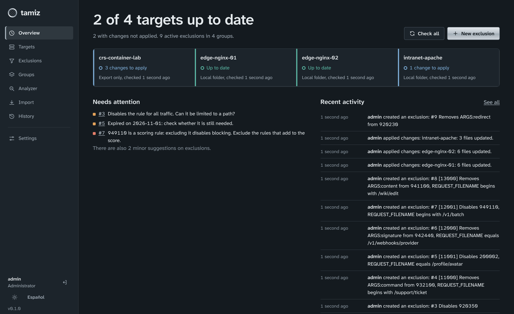

# Tamiz

**English** · [Español](README.es.md)

**Manage ModSecurity / OWASP CRS exclusions across many WAFs from one web interface.**

Tamiz keeps every rule exclusion in one place, organised by application, with its reason and review date. It writes them to each WAF over SSH, the Docker API, a mounted directory or a downloadable bundle. It validates before and after, reloads, checks that the rules were actually loaded, and restores the previous files if anything fails.

> Status: **alpha** (0.1.0). Tested end to end against nginx + libmodsecurity 3 and Apache + mod_security2 with the OWASP CRS. Some paths are not yet tested against real systems: see [Not tested yet](#not-tested-yet).



- [What it does](#what-it-does)
- [How it works](#how-it-works)
- [Requirements](#requirements)
- [Install with Docker](#install-with-docker)
- [Configuration](#configuration)
- [Publish it with TLS](#publish-it-with-tls)
- [Users, roles and API tokens](#users-roles-and-api-tokens)
- [Connect your first WAF](#connect-your-first-waf)
- [Other platforms](#other-platforms)
- [Other ways to reach a WAF](#other-ways-to-reach-a-waf)
- [Everyday use](#everyday-use)
- [Backup and restore](#backup-and-restore)
- [Upgrade](#upgrade)
- [Troubleshooting](#troubleshooting)
- [Security](#security)
- [Not tested yet](#not-tested-yet)
- [Run without Docker](#run-without-docker)
- [Development](#development)
- [License](#license)

## What it does

- **Exclusions as data**: runtime (`ctl:ruleRemoveById`, `ctl:ruleRemoveTargetById`, `ctl:ruleEngine`) with path, host, method or IP conditions, and configure-time (`SecRuleRemoveById`, `SecRuleUpdateTargetById`…). Anything else can be written as raw SecLang.
- **Groups with ID blocks**: each application gets its own block of rule IDs inside the local range (1–99,999), so IDs never collide and tell you who owns a rule.
- **Plan, then apply**: see the exact diff for each file before anything is written. Applying is all or nothing per WAF: snapshot → atomic write → validate (`nginx -t`, `apachectl -t`…) → reload, or restore and do not reload.
- **Verifies the WAF really loaded it**: SELinux labels, position of each file relative to the CRS in the real load order, and the rule count reported by the validation.
- **Never overwrites what it did not write**: hand edits and unknown files block the plan until someone decides.
- **Two file layouts**: one file per group in its own directories (two `Include` lines, minimal sudo), or managed blocks inside existing files such as `REQUEST-900-EXCLUSION-RULES-BEFORE-CRS.conf`.
- **Log analyzer**: reads audit logs (serial or JSON, ModSecurity v2/v3, Coraza) or error logs and proposes the narrowest exclusion for each false positive.
- **Import existing exclusions** without changing their meaning (unrecognised rules are kept verbatim), renumber them into the group's block, and retire them from the original file in the same apply.
- **Linter** for risky exclusions (removing scoring rules, turning the engine off, rules removed for all traffic…).
- **Four-eyes reviews** per WAF, full history, roles (viewer, editor, admin), local users or SSO through an authenticating reverse proxy, API tokens.
- Interface in English and Spanish; plain HTML, CSS and JavaScript (no build step).

## How it works

```text
groups + exclusions (in Tamiz)
        │  render: one deterministic file per group, or blocks in existing files
        ▼
plan per WAF: create / update / delete, with a diff; hand-edited or unknown files block it
        │  apply (only the plan you saw, identified by its hash)
        ▼
snapshot → atomic write → validate → reload → verify (SELinux, load order, rule count)
        └── if validation fails: restore the snapshot and do not reload
```

A WAF that Tamiz manages is called a **target**. Runtime exclusions go in files loaded **before** the CRS rules, configure-time exclusions in files loaded **after** them. Tamiz writes its files, and the WAF loads them through two `Include` lines you add once.

Tamiz is a single Python process with SQLite. It needs no external database and runs no background jobs: everything happens when someone clicks or calls the API.

## Requirements

- **Docker** with the Compose plugin (`docker compose`). It also runs without Docker: see [Run without Docker](#run-without-docker).
- **Network access** from the Tamiz host to each WAF: SSH in most cases. Alternatives: the Docker API, or the WAF's directory mounted into Tamiz.
- **A WAF** with ModSecurity and the OWASP CRS, one of:
  - nginx + libmodsecurity 3;
  - Apache httpd + mod_security2;
  - the `owasp/modsecurity-crs` container image;
  - Caddy + Coraza.

  The end-to-end tests run on Ubuntu 24.04 packages: nginx 1.24, libmodsecurity 3.0.12 and CRS 3.3.5, and Apache with mod_security2.
- **On each WAF host**: a dedicated user for Tamiz and `sudo` for a few commands (Tamiz suggests the exact line).
- **A TLS reverse proxy** if people will use Tamiz from other machines. By default it only listens on `127.0.0.1`.

## Install with Docker

```bash
git clone https://github.com/Zaporitecua/tamiz.git && cd tamiz
cp .env.example .env

# SSH key Tamiz will use to log in to your WAF hosts (or copy an existing one here)
mkdir -p keys
ssh-keygen -t ed25519 -N '' -C tamiz -f keys/tamiz_ed25519
sudo chown 10001 keys/*          # the container runs as uid 10001

docker compose up -d --build
docker compose logs tamiz | grep "setup code"
```

Open <http://127.0.0.1:8080>, enter the setup code and create the first administrator (password: at least 10 characters). The code is printed again on every start until an administrator exists.

To skip the code, set `TAMIZ_ADMIN_USER` and `TAMIZ_ADMIN_PASSWORD` in `.env` before the first start. Then remove the password from the file.

Check that it is healthy:

```bash
docker compose ps                         # STATUS: healthy
curl -s http://127.0.0.1:8080/api/health  # {"status":"ok","version":"0.1.0"}
docker compose logs --tail 20 tamiz       # "Tamiz 0.1.0 ready (schema 1, auth local)"
```

What lives where:

| In the container | What | Comes from |
|---|---|---|
| `/data/tamiz.db` | the database: exclusions, groups, targets, users, history, snapshots | volume `tamiz-data` |
| `/data/secret.key` | key that encrypts stored passwords and pasted keys; created with the first one (unless `TAMIZ_SECRET_KEY` is set) | volume `tamiz-data` |
| `/keys` | SSH private keys and Docker client certificates, read only | `./keys` |
| `/waf/…` | WAF directories for the local transport (optional) | whatever you mount |
| `/var/run/docker.sock` | Docker transport (optional, read [Security](#security) first) | the host's socket |

The database lives in the `tamiz-data` volume, not inside the container: it survives the container crashing, restarting or being rebuilt. It is only deleted with `docker compose down -v` or if you remove the volume.

## Configuration

Infrastructure settings are environment variables in `.env`, read once at start. An invalid value stops the start with a message that names it. Settings that administrators change in the interface (ID range, rule format, whether a reason is required…) live in the database, under *Settings*.

**General**

| Variable | Default | What it does |
|---|---|---|
| `TAMIZ_DATA_DIR` | `/data` | Database and `secret.key` (set by the `Dockerfile`) |
| `TAMIZ_KEYS_DIR` | `/keys` | SSH keys and Docker certificates; relative key names in targets are looked up here |
| `TAMIZ_LOG_LEVEL` | `INFO` | `DEBUG`, `INFO`, `WARNING` or `ERROR` |
| `TAMIZ_COMMAND_TIMEOUT` | `60` | Seconds per remote command, unless the target sets its own |

**Authentication**

| Variable | Default | What it does |
|---|---|---|
| `TAMIZ_AUTH_MODE` | `local` | `local` (users stored in Tamiz), `proxy` (an authenticating reverse proxy logs users in) or `none` (no login: only for a lab nobody else can reach) |
| `TAMIZ_ADMIN_USER`, `TAMIZ_ADMIN_PASSWORD` | — | Create this administrator on start if there is none, instead of the setup code |
| `TAMIZ_SESSION_HOURS` | `12` | Session length |
| `TAMIZ_COOKIE_SECURE` | `auto` | `auto` (from the request, or `X-Forwarded-Proto` from a trusted proxy), `true` or `false`. Behind HTTPS, set `true` |

**Proxies**

| Variable | Default | What it does |
|---|---|---|
| `TAMIZ_TRUSTED_PROXIES` | `127.0.0.1/32,::1/128` | Networks (CIDR, comma separated) allowed to send `X-Forwarded-For`, `X-Forwarded-Proto` and, in proxy mode, the user header |
| `TAMIZ_PROXY_USER_HEADER` | `X-Forwarded-User` | Header with the user name (proxy mode) |
| `TAMIZ_PROXY_GROUPS_HEADER` | `X-Forwarded-Groups` | Header with the user's groups, comma or semicolon separated |
| `TAMIZ_PROXY_ADMIN_GROUPS` | — | Groups that get the admin role |
| `TAMIZ_PROXY_EDITOR_GROUPS` | — | Groups that get the editor role |
| `TAMIZ_PROXY_DEFAULT_ROLE` | `viewer` | Role for users in none of those groups: `viewer`, `editor`, `admin` or `none` (denied) |

**Secrets and transports**

| Variable | Default | What it does |
|---|---|---|
| `TAMIZ_SECRET_KEY` | — | Fernet key for stored credentials. If empty, Tamiz creates `/data/secret.key`. Generate one with `python3 -c "from cryptography.fernet import Fernet; print(Fernet.generate_key().decode())"` |
| `TAMIZ_LOCAL_ROOTS` | `/waf` | Directories (comma separated) the local transport may read and write |
| `TAMIZ_DOCKER_HOST` | `unix:///var/run/docker.sock` | Default Docker API for the Docker transport (`unix://`, `tcp://` or `https://`); each target can use another |

Changing `TAMIZ_SECRET_KEY` (or losing `secret.key`) makes the stored passwords unreadable: they have to be typed again.

## Publish it with TLS

`docker-compose.yml` publishes Tamiz only on `127.0.0.1:8080`. Put a reverse proxy with TLS in front; `examples/nginx-reverse-proxy.conf` is a complete nginx example. It also works under a path prefix such as `/tamiz/`, because the interface uses relative URLs.

Then, in `.env`:

```bash
TAMIZ_COOKIE_SECURE=true
```

So that the login throttle sees each user's real IP, trust the proxy. A proxy on the same host reaches the container from the gateway of the Docker network, not from 127.0.0.1:

```bash
docker network inspect tamiz_default -f '{{(index .IPAM.Config 0).Gateway}}'   # <folder>_default
# for example 172.18.0.1  →  TAMIZ_TRUSTED_PROXIES=172.18.0.1/32
docker compose up -d     # apply the change
```

An apply can take a while on a slow server, and uploaded logs can be up to 20 MB. The example sets `proxy_read_timeout 180s` and `client_max_body_size 25m` for that.

## Users, roles and API tokens

**Roles**: `viewer` < `editor` < `admin`. The API checks the role on every endpoint.

| Role | Can |
|---|---|
| viewer | See everything; check targets (read only: connects and reads Tamiz's files); load order; download bundles; analyze pasted logs; export the JSON backup; own API tokens |
| editor | Groups and exclusions; assign groups to targets; apply, validate and reload; request and decide reviews; import and retire rules; analyze logs read from the server |
| admin | Targets with their credentials, commands and paths; diagnosis; reset a server's SSH key; users; settings |

**Local users** (`TAMIZ_AUTH_MODE=local`): passwords hashed with scrypt, sessions in an `HttpOnly`, `SameSite=Strict` cookie. 5 failed logins per user and IP in 15 minutes block that pair for a while.

**Single sign-on** (`TAMIZ_AUTH_MODE=proxy`): an authenticating proxy (oauth2-proxy, Authelia, Authentik…) logs users in and passes the user name and groups in headers. The role comes from the groups. Two conditions:

- the proxy must **overwrite** the user header sent by the client;
- Tamiz must not be reachable without going through the proxy.

Add the proxy's address to `TAMIZ_TRUSTED_PROXIES`. The end of `examples/nginx-reverse-proxy.conf` shows an oauth2-proxy setup.

**API tokens**: *Settings → API tokens*. A token has the role of the user who created it and an optional expiry, and is shown only once. Use it as `Authorization: Bearer tmz_…`; token requests do not need the `X-Tamiz` header that browser requests need. The API reference is at `/api/docs`.

## Connect your first WAF

The most common case: nginx + libmodsecurity 3, over SSH.

### 1. On the WAF host

```bash
# A dedicated user with Tamiz's public key (keys/tamiz_ed25519.pub)
sudo useradd --system --create-home --shell /bin/sh tamiz
sudo install -d -m 700 -o tamiz -g tamiz ~tamiz/.ssh
echo 'ssh-ed25519 AAAA... tamiz' | sudo tee ~tamiz/.ssh/authorized_keys
sudo chown tamiz: ~tamiz/.ssh/authorized_keys && sudo chmod 600 ~tamiz/.ssh/authorized_keys

# Tamiz's own directories, owned by that user
sudo install -d -o tamiz -g tamiz -m 755 /etc/nginx/modsec/tamiz/before /etc/nginx/modsec/tamiz/after
```

On RHEL and derivatives with SELinux, new directories under `/etc/nginx` inherit the right label. Tamiz runs `restorecon` after writing and checks the result.

### 2. Create the target in Tamiz

1. *Targets → New target*, platform **nginx + libmodsecurity (v3)**. The preset fills in typical paths: check them, they differ between distributions.
2. Connection: **SSH**, host, port, user `tamiz`, *Key in /keys*: `tamiz_ed25519`. You can also store a password or paste a key; both are encrypted. A jump host is supported.
3. *Privileges*: **sudo for commands**. Check the validate, reload and discover commands and the log paths.
4. Files: **One file per group**, for example `/etc/nginx/modsec/tamiz/before/{block}-{group}.conf`.
5. Save.

### 3. sudo

The form shows a sudoers line for that target. Copy it to the WAF host, for example:

```text
tamiz ALL=(root) NOPASSWD: /usr/sbin/nginx -t, /usr/sbin/nginx -s reload, /usr/sbin/nginx -T, \
    /usr/bin/tail ^-c [0-9]+ -- /var/log/modsec_audit\.log$, \
    /usr/bin/tail ^-c [0-9]+ -- /var/log/nginx/error\.log$, \
    /usr/bin/true
```

```bash
sudo visudo -f /etc/sudoers.d/tamiz
sudo visudo -cf /etc/sudoers.d/tamiz
```

Use full paths (`command -v nginx`). `examples/sudoers-tamiz` has the Apache variant.

The `tail` lines are regular expressions (`^…$`, sudo 1.9.10 or later; check with `sudo --version`). Don't replace them with `tail -c * -- <log>`: in sudoers a `*` also matches spaces, so `tail -c 1 /etc/shadow -- <log>` would match and the `tamiz` user could read any file as root. With an older sudo (RHEL/Oracle Linux 7 and 8, and 9 before 9.8, ship 1.9.5 or older), leave the `tail` lines out: everything else works, but Tamiz can't read that target's logs.

### 4. Diagnosis

Open the target, tab *Diagnosis* (admins), and run it. It tests the connection, writable directories, sudo, validation, SELinux and access to the logs.

The first connection pins the server's SSH key. Compare the fingerprint it shows with `ssh-keygen -lf /etc/ssh/ssh_host_ed25519_key.pub` on the server.

### 5. First apply, before touching nginx

Create a group (*Groups → New group*) and assign it to the target. Then **Check** and **Apply**. Tamiz writes the group's files and a placeholder file (`000-tamiz-keep.conf`) in each directory. nginx does not load them yet.

### 6. Add the two `Include` lines, once

In the file loaded by `modsecurity_rules_file` (often `/etc/nginx/modsec/main.conf`), put Tamiz's two lines around the lines that load the CRS:

```apache
Include /etc/nginx/modsec/modsecurity.conf
Include /etc/nginx/modsec/tamiz/before/*.conf     # add: runtime exclusions, before the CRS
Include /etc/nginx/modsec/coreruleset/crs-setup.conf
Include /etc/nginx/modsec/coreruleset/rules/*.conf
Include /etc/nginx/modsec/tamiz/after/*.conf      # add: configure-time exclusions, after the CRS
```

```bash
sudo nginx -t && sudo nginx -s reload
```

Your CRS paths may be different; only the position of Tamiz's lines matters. The order of steps 5 and 6 matters too: libmodsecurity 3 rejects an `Include` whose wildcard matches no file. To add the lines first anyway, create empty placeholders before. Tamiz adopts empty files:

```bash
sudo -u tamiz touch /etc/nginx/modsec/tamiz/{before,after}/000-tamiz-keep.conf
```

### 7. Confirm

- Tab *Load order*: Tamiz's files appear with a steel rim, *before* above the CRS and *after* below it.
- **Check**: the target shows *Up to date*.

From here on, every change is: edit exclusions → **Check** → review the diff → **Apply**.

## Other platforms

| Platform (preset) | What changes |
|---|---|
| **Apache httpd + mod_security2** | Commands `apachectl -t`, `apachectl graceful`, `apachectl -t -D DUMP_INCLUDES`. Directories `/etc/modsecurity/tamiz/{before,after}`. Add `IncludeOptional /etc/modsecurity/tamiz/before/*.conf` before the lines that load the CRS and `…/after/*.conf` after them. Debian: `/etc/apache2/mods-enabled/security2.conf`; RHEL: `/etc/httpd/conf.d/mod_security.conf`. If your `Include` paths are relative, set *Relative Include paths* to *Relative to ServerRoot* and fill in *ServerRoot* |
| **OWASP CRS container image** (`owasp/modsecurity-crs`) | Docker transport, container `waf`. Tamiz writes `tamiz-…-before.conf` and `-after.conf` into `/etc/modsecurity.d/owasp-crs/plugins/`, which the image already loads around the CRS: nothing to add. Mount that directory as a volume so the files survive the container. **Paths not verified against the current image**: confirm them in *Load order* before applying. Lab: `examples/crs-container/docker-compose.yml` |
| **Caddy + Coraza** | `caddy validate` / `caddy reload`. Add the two Tamiz lines among the Coraza directives of your Caddyfile, around the CRS. Coraza has no `-T`: fill in *Entry files* so Tamiz can follow the load order. **Not tested** |
| **Existing exclusion files** (REQUEST-900 / RESPONSE-999) | Layout *Blocks in existing files*: Tamiz edits only its own marked blocks inside those files and keeps everything else. Nothing to add if the CRS loads `rules/*.conf`. Needs *sudo for everything*, because the files belong to root |
| **Custom** | Everything empty, for any other setup |

Each target shows its own `Include` snippet under *Configuration*.

## Other ways to reach a WAF

- **WAF in a container on another host, or in Kubernetes**: SSH to the host, with a *Command prefix* such as `docker exec waf` or `kubectl exec -n waf deploy/waf --`. The prefix also goes in the sudoers line if sudo is used.
- **WAF on the same host as Tamiz**: transport *Local folder*. Mount the WAF's directory under `/waf` in `docker-compose.yml` (there is a commented example), writable by uid 10001. A container usually cannot validate or reload the host's nginx, so those commands stay empty and you reload outside Tamiz. Without a validate command Tamiz cannot catch and roll back a broken file, so prefer SSH to the same host when you can.
- **WAF containers on the Docker host**: transport *Docker API*. Uncomment the `docker.sock` line in `docker-compose.yml`. The container runs as uid 10001, so give it the socket's group: `group_add: ["<gid>"]`, with the gid from `stat -c %g /var/run/docker.sock`. A remote Docker API over `https://` with client certificates in `/keys` also works. Read the Docker notes in [Security](#security) first.
- **No access at all** (changes by ticket, Ansible, GitOps): transport *Export only*. *Download bundle* gives a `.zip` with the files at their absolute paths, a manifest with hashes and a README. After deploying it, *Mark as deployed*.

## Everyday use

- **Groups**: usually one per application or site. Each owns a block of rule IDs and is deployed to one or more targets.
- **Exclusions**: the form shows the SecLang that Tamiz will write and the linter's findings while you type. Each exclusion records a reason (*Settings* can make it required), and optionally a reference and a *Review on* date that raises a warning when it comes.
- **Analyzer**: reads a target's audit or error log, or a pasted one. It groups the matches and turns the false positives you select into an exclusion draft. Scoring rules (949xxx, 980xxx) are listed apart, on purpose.
- **Import**: brings in exclusions that already exist on a server, or in pasted text. It can renumber them into the group's block and retire them from the original file in the same apply. Retiring from root-owned files needs *sudo for everything* while you migrate.
- **Reviews**: with *Require another person's review before applying*, an editor asks for a review of the exact plan and someone else approves it (unless *Settings* allows self-approval).
- **History**: every change, apply, import and login, with the steps of each apply and the snapshot of the files before it.
- **Settings → Data → Export**: groups and exclusions as JSON. Use it to copy them to another Tamiz (test → production) or to keep them in Git. It is not a full backup.

## Backup and restore

Back up the database and the encryption key **together**: one without the other is incomplete. Together they give access to your WAF hosts, so store them like other admin credentials. Back up `./keys` and `.env` too.

Hot backup (SQLite in WAL mode: do not just copy the file while Tamiz runs):

```bash
STAMP=$(date +%Y%m%d-%H%M)
docker compose exec tamiz python -c "
import sqlite3
src = sqlite3.connect('/data/tamiz.db'); dst = sqlite3.connect('/data/backup.db')
src.backup(dst); dst.close(); src.close()"
docker compose cp tamiz:/data/backup.db ./tamiz-$STAMP.db
docker compose cp tamiz:/data/secret.key ./tamiz-$STAMP.key   # exists once a password or key is stored
docker compose exec tamiz rm /data/backup.db
```

With `TAMIZ_SECRET_KEY` the key is in `.env` and there is no `secret.key` to copy.

Restore, with the image you already built (`docker volume ls` shows the volume's name: `<folder>_tamiz-data`):

```bash
docker compose stop tamiz
docker run --rm --user 0 --entrypoint sh \
  -v tamiz_tamiz-data:/data -v "$PWD":/restore tamiz:latest -c '
  rm -f /data/tamiz.db-wal /data/tamiz.db-shm &&
  cp /restore/tamiz-YYYYMMDD-HHMM.db /data/tamiz.db &&
  cp /restore/tamiz-YYYYMMDD-HHMM.key /data/secret.key &&
  chown 10001 /data/tamiz.db /data/secret.key && chmod 600 /data/secret.key'
docker compose start tamiz
```

With `TAMIZ_SECRET_KEY` there is no `.key` file: leave out the line that copies it.

Afterwards, **Check** every target. Anything newer on the servers than the backup shows up as drift: Tamiz does not overwrite it without confirmation.

Lost the key? The database still works; only stored passwords and pasted keys become unreadable (`secret_unreadable`). Edit those targets and type them again. Keys in `./keys` are not affected.

## Upgrade

```bash
# back up first (see above)
git pull
docker compose up -d --build
docker compose logs --tail 20 tamiz     # "Tamiz … ready (schema N, …)"
```

Database migrations run automatically on start.

`docker compose down` stops and removes the container but keeps the data. `docker compose down -v` also **deletes the data volume**.

## Troubleshooting

Start with the target's *Diagnosis* tab. Messages in the interface come from codes, shown below in parentheses.

| Symptom | Cause and fix |
|---|---|
| No setup code | `docker compose logs tamiz \| grep "setup code"`. It is printed on every start until an administrator exists |
| "Request rejected for safety" (`csrf`) | Missing `X-Tamiz` header. In the browser, reload the page. In scripts, use an API token |
| Too many attempts (`too_many_attempts`) | 5 failures in 15 minutes for that user and IP. Wait, or restart the container. If every user shares one IP, add the proxy to `TAMIZ_TRUSTED_PROXIES` |
| Proxy mode always asks to log in | The log says `ignored X-Forwarded-User header from <ip>`: add that IP to `TAMIZ_TRUSTED_PROXIES`. No such line: the proxy is not sending the header named in `TAMIZ_PROXY_USER_HEADER` |
| `unreachable` | Network, port or name. Test from the container: `docker compose exec tamiz python -c "import socket; socket.create_connection(('HOST', 22), 5)"` |
| `auth_failed` | The public key is not in the user's `authorized_keys`, or `~/.ssh` permissions are too open (sshd ignores the key) |
| `key_not_found` | The name does not match a file in `./keys`, or uid 10001 cannot read it: `sudo chown 10001 keys/*` |
| `host_key_mismatch` | The server's SSH key changed: reinstall, a different machine behind the name, or interception. Compare fingerprints **by another channel**, then *Configuration → Reset server key* |
| sudo asks for a password | The sudoers line is missing or does not match exactly (full paths, same arguments). On the server: `sudo -l -U tamiz` |
| *Check permissions* fails | The user cannot write those files: `chown` Tamiz's directories to it, or *sudo for everything* for root-owned files |
| *Validate* failed, files restored (`rolled_back`) | What was written does not pass the WAF's validation; the step shows the WAF's error. With structured exclusions this should not happen: suspect raw SecLang |
| *Reload* failed (`reload_failed`) | Files are valid and written, but the reload command failed. Reload by hand or from the target |
| *Verify it loaded*: the rule count did not change | The files are on disk but the WAF did not read them: missing `Include`, a wildcard that does not cover them, or SELinux (`ls -Z`, `restorecon -v <path>`) |
| Files blocked (`drift`, `foreign`) | A Tamiz file was edited by hand, or a file Tamiz wants to create already exists. Look at the diff; keep the change as an exclusion (or import it), then force that path |
| `plan_changed` | Something changed since you saw the plan. **Check** again |

Logs: `docker compose logs -f tamiz`. Unexpected errors are logged with their trace (`unhandled error on …`).

## Security

Tamiz holds credentials to your WAF hosts and decides what your WAF blocks: treat it as an admin tool.

- **Least privilege on the WAF hosts**: a dedicated user, Tamiz's files in their own directories, and *sudo for commands*. *sudo for everything* is equivalent to root: use it only while migrating rules out of root-owned files.
- **Credentials**: stored passwords and pasted keys are encrypted (Fernet) and never returned by the API.
- **SSH**: the server's key is pinned on first use (also for the jump host). A changed key stops every command until an admin resets it.
- **No shell injection**: file contents and paths travel as base64 arguments or validated paths, never interpolated into commands.
- **Browser**: strict Content Security Policy (no inline scripts or styles), a CSRF header on every change, `SameSite=Strict` cookies, scrypt password hashes, login throttling.
- **Docker socket**: mounting `/var/run/docker.sock` gives Tamiz, and whoever controls it, full control of every container on the host, which means the host. In order of preference, use instead:
  - SSH with `docker exec` as a command prefix;
  - a socket proxy that only allows the exec and inspect endpoints;
  - a remote Docker API over `https://` with a client certificate.
- **What a valid exclusion can do**: validation catches broken files, not exclusions that are too broad. That is what the linter and reviews are for.
- **Not covered**: no multi-tenancy (every user sees every target), no per-group permissions, no built-in MFA (use proxy mode with a provider that has it), no encryption of the database at rest beyond the credentials.

To report a vulnerability, use *Report a vulnerability* in the repository's *Security* tab instead of a public issue.

## Not tested yet

- The Docker transport against a real Docker engine. It was tested against a simulated API.
- The paths of the `crs-docker` preset inside the official image.
- Caddy + Coraza.
- Real SELinux. It is simulated in the tests.
- `kubectl exec` command prefixes.
- SSH jump hosts.
- Building the container image itself. The application has been run the way the image runs it: Python 3.12, uid 10001, the same command and health check.

## Run without Docker

Python 3.11 or newer (the image uses 3.12):

```bash
git clone https://github.com/Zaporitecua/tamiz.git /opt/tamiz && cd /opt/tamiz
python3 -m venv .venv && .venv/bin/pip install -r requirements.txt
TAMIZ_DATA_DIR=/var/lib/tamiz TAMIZ_KEYS_DIR=/etc/tamiz/keys \
  .venv/bin/uvicorn tamiz.main:app --host 127.0.0.1 --port 8080 --no-server-header --no-proxy-headers
```

Keep `--no-proxy-headers`: Tamiz reads `X-Forwarded-*` itself, and only from `TAMIZ_TRUSTED_PROXIES`. Run it as an unprivileged user that owns the data directory. A systemd unit could look like this, with the rest of the variables in `/opt/tamiz/.env`:

```ini
[Unit]
Description=Tamiz
After=network-online.target

[Service]
User=tamiz
WorkingDirectory=/opt/tamiz
Environment=TAMIZ_DATA_DIR=/var/lib/tamiz TAMIZ_KEYS_DIR=/etc/tamiz/keys
EnvironmentFile=/opt/tamiz/.env
ExecStart=/opt/tamiz/.venv/bin/uvicorn tamiz.main:app --host 127.0.0.1 --port 8080 --no-server-header --no-proxy-headers
Restart=on-failure

[Install]
WantedBy=multi-user.target
```

## Development

```bash
python3 -m venv .venv && . .venv/bin/activate
pip install -r requirements-dev.txt
python3 -m pytest -q                       # 79 passed, 3 skipped (the real-WAF labs)
for f in tamiz/static/js/*.js tamiz/static/js/views/*.js; do node --check "$f"; done
mkdir -p data keys waf
TAMIZ_DATA_DIR=./data TAMIZ_KEYS_DIR=./keys TAMIZ_LOCAL_ROOTS=$PWD/waf \
  uvicorn tamiz.main:app --port 8800 --reload --no-proxy-headers
```

The backend is Python with FastAPI and SQLite, with no ORM. The interface is plain HTML, CSS and JavaScript modules, with no framework and no build step. The backend sends error codes, and the interface translates them; every code needs a Spanish and an English text in `tamiz/static/js/i18n.js`, and `tests/test_i18n.py` checks it.

End-to-end tests against real nginx and Apache run on a disposable Ubuntu 24.04, as root. They rewrite the WAF configuration, so never run them against a real server:

```bash
sh tests/e2e/lab-nginx.sh && sh tests/e2e/lab-apache.sh
TAMIZ_E2E=1 python3 -m pytest -q tests/e2e
```

Bug reports and pull requests are welcome in GitHub Issues.

## License

Apache License 2.0. See `LICENSE` and `NOTICE`. Bundled fonts (Atkinson Hyperlegible Next and Mono) are under the SIL Open Font License 1.1.
